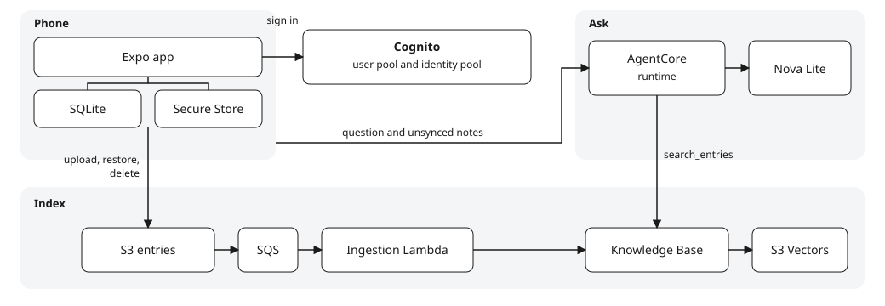

# ai-journal

A personal journal. You write entries on the phone, then ask about them in plain English. The agent searches the history and returns the entries it used.

Writing stays on the phone, so it works offline. Each entry uploads to S3 when the network is available, and that upload is what gets indexed. Asking needs the network. Answers come from Amazon Bedrock through a Python agent on AgentCore.

The reviewed design and build order are in [docs/plan.md](docs/plan.md).

## Architecture

The phone keeps the journal. AWS keeps the searchable copy and writes the answer.

Saving writes SQLite and returns. The app uploads and deletes under `entries/` when it is online, using the identity-pool role. An empty journal copies those objects back. S3 events become one Knowledge Base ingestion job per burst, and the Knowledge Base embeds them with Titan into S3 Vectors. A question goes to the AgentCore runtime. The runtime searches the Knowledge Base once, then Nova Lite writes the summary. Notes still waiting to upload travel with the question.

## Stack

- React Native with Expo, and SQLite on the phone. The app is in [app/](app/). Launch it on the Android emulator with the steps in [app/README.md](app/README.md).
- S3 for the uploaded entries, a Bedrock Knowledge Base, and S3 Vectors.
- A Python agent on AgentCore Runtime, with one tool, `search_entries`.
- Cognito for a single pre-created user. There is no sign-up.
- Terraform in `eu-west-2`. GitHub Actions applies it with OIDC. The workflow stores no AWS access keys.

## Layout

- `agent/` is the AgentCore entrypoint.
- `ingestion/` is the Lambda that starts one Knowledge Base ingestion job per burst of uploads.
- `infra/` is the main stack. `infra/bootstrap/` is applied once from a laptop and creates the state bucket, the lock table, and the deploy role.
- `.github/workflows/terraform.yml` checks formatting on a pull request. A push to `main` plans, then applies after approval on the `production` environment.

## What stays out of git

Journal entries, Terraform state, and `terraform.tfvars` are not committed. The deploy role can be assumed only from `main` and from the `production` environment, so a pull request cannot receive AWS credentials.
