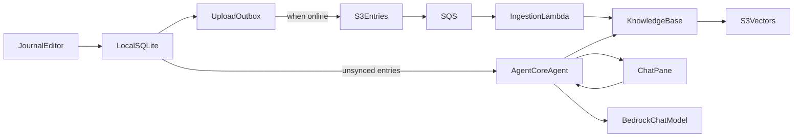
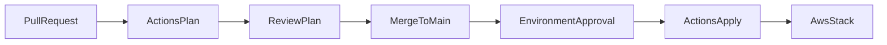

# Personal journal, first version

You write journal entries, then ask about them in plain English. The agent searches the whole history and returns the related entries. A question can be about a subject, a time, or both. The wording is not fixed in advance.

Two choices are confirmed:

- Entries live on the phone and upload to S3 when online. S3 events index them for RAG, so AWS holds the searchable copy.
- Answers come from Amazon Bedrock through a Python agent on AgentCore. Writing works offline. Asking needs the network.

Writing stays on the phone so it works offline. Each save is uploaded when the network is available. The S3 write is the event that starts indexing. A queue sits in front of that sync so a burst of edits becomes one Knowledge Base ingestion job. Bedrock allows only one ingestion job per data source at a time, and a Knowledge Base does not sync itself when objects change.

The phone remains the writing store. AWS holds the searchable copy, because the agent runs in AgentCore and semantic retrieval is the reason to use Bedrock. AgentCore Memory is conversation state, not the journal and not the vector index.

## Decisions for v1

- **App:** React Native with Expo, so one project covers the phone you use. Local entries live in SQLite.
- **Screens:** One layout pass before the Expo app. Sign-in is the front door. Behind it are the list, the editor, and the chat. The layout includes the empty list, a tag filter with no matches, sync states (on the phone, uploaded, failed), and chat with no network. No Figma file and no design system in v1. The app steps follow that layout.
- **Entry:** id, date, body, tags (`life`, `work`, `thoughts`, `learnings`; an entry may have several), plus a sync state.
- **Cloud documents:** `entries/{id}.md` and a sidecar `entries/{id}.md.metadata.json` containing `entryId`, `date`, and `tags`. `date` is stored as `YYYYMMDD` so a question can filter a range. Edits overwrite the same keys. Deletes remove both objects.
- **Index:** Bedrock Knowledge Base over that bucket, with S3 Vectors as the vector store. S3 Vectors fits a personal corpus. OpenSearch Serverless is a later choice if hybrid keyword search becomes necessary.
- **Ingestion:** S3 events go to SQS. One Lambda calls `StartIngestionJob`. Batch or delay the queue so rapid uploads collapse into a single sync. If a job is already running, the Lambda treats the conflict as success because the running incremental sync picks up the new objects.
- **Questions:** The chat takes a plain-English question and finds related entries across the whole journal. The match is on what the entries say, not on the four tags. When the question mentions a time, the search is limited to that range. The prompt defines "last year" as the previous calendar year, "last week" as the previous seven days, and "this day last month" as the same day in the previous month. Other time wording becomes a date range the model fills in. A question can ask for the entries, a summary of a time window, or a conclusion from a subject. A conclusion quotes what the entries say and leaves personality, politics, and mental health unstated unless an entry states them. A summary or a conclusion says how many entries the search returned. An empty search is a finished answer: the journal does not contain it, and the model adds nothing. The sample questions are examples, not a fixed list.
- **Agent:** A small Python entrypoint on AgentCore Runtime, deployed as a zip artifact and defined with Terraform `aws_bedrockagentcore_agent_runtime`. It has one tool, `search_entries`. The model gets today's date and may call that tool once, with a rewritten query and an optional date range. When the question is about a time and not a subject, the tool returns every entry in that window, date filter first. When the question has a subject, it searches by meaning inside the window, or across the whole journal if no time was given. Results are whole entries deduped by id. The model then lists those entries, summarises them, or draws a conclusion from them, and all three stay inside that set. A week of entries fits in one reply. A conclusion about a subject uses the related entries that came back, and the reply cites them rather than claiming the whole history was read. A full year is the case that gets too large for one summary. There is no second search and no other tool. AgentCore Browser, Code Interpreter, and Gateway are not used. No multi-agent framework in v1.
- **Citations:** The response includes the entry ids returned by retrieval, not ids the model invents. Each cited entry shows its date and the first line of the body, so the note is recognisable before it is opened. Tapping one opens it.
- **Auth:** Cognito for a single user created in the stack, so the app has sign-in and sign-out, not sign-up. Every screen except sign-in stays behind that session, including reading and writing entries. The session is stored on the device, so a later launch works offline until sign-out or expiry. Sign-out returns to the sign-in screen and shows no entries. The signed-in app can write only under the entries prefix and can invoke only this agent runtime. In v1 the SQLite file is not encrypted; the gate stops someone opening the app, and the phone's own lock protects the device.
- **Region:** One region for the whole stack. Prefer London (`eu-west-2`) if AgentCore Runtime, Knowledge Bases, and S3 Vectors are all available there. Otherwise use the nearest region that has all three.
- **Logging:** Bedrock invocation logging is off. Journal text already lives in S3 and in the vector index, and prompts are not copied into CloudWatch.
- **Repository:** Public, so the project can sit in a portfolio. Journal entries, Terraform state, and `terraform.tfvars` stay out of git. The deploy role can be assumed only from `main` and from the `production` environment, so a pull request cannot receive AWS credentials. The trust uses GitHub's immutable subject, which includes the owner id and the repository id.
- **CI/CD:** GitHub Actions is the way AWS changes ship. The workflow authenticates with GitHub OIDC, so the repo stores no AWS access keys. Bootstrap is applied once from the laptop. A pull request runs `terraform fmt` and `terraform validate` with no AWS credentials. A push to `main` runs `terraform plan`, then `terraform apply` only after approval on a GitHub Environment named `production`. That Terraform workflow exists before the entry bucket is applied. Pytest, Jest, and the agent zip are added to it once those projects exist. An installable app build is a separate manual workflow through EAS.
- **Tests:** Each step brings the tests for the behavior it adds. Pull-request tests are local and use fakes: pytest for the agent and the ingestion Lambda, Jest for the app. They cover the entry document shape, sync states, the sign-in gate, citation ids taken from retrieval, and one ingestion job per burst. They do not call Bedrock, S3, or a device. `terraform fmt` and `terraform validate` run in that same pull request. A live question against a deployed fixture stays a manual check after apply. Screens are built so a later device pass can drive them. A LocalStack copy of Bedrock is out of v1.
- **Spec in the repo:** The reviewed design is committed as [docs/plan.md](docs/plan.md). That file holds both the decisions and the build order, and it omits the Cursor todo frontmatter. There is no separate decisions file. Design changes update both that file and this working plan. Cursor's own plan file stays the local checklist for this chat.
- **UI testability:** Every screen, input, button, list row, and citation gets a stable `testID`. Routes have names. Entry, sync, and document logic stay in modules the Jest tests already cover, so screens stay thin. The later device pass uses Maestro. Writing those flows is a later pass, not part of the first build.
- **RAG evaluation:** Two layers. Deterministic checks compare entry ids and stay in pytest: the golden questions in [agent/evals/golden.jsonl](agent/evals/golden.jsonl) expect specific entry ids, and a model reply cannot add one. Non-deterministic checks are Amazon Bedrock Evaluations, bring-your-own inference responses, run on demand after a deploy. The agent already returns the answer text, the retrieved passages, and the Knowledge Base id, which is the shape that job needs. The first job scores `Builtin.Faithfulness`, `Builtin.CitationPrecision`, `Builtin.CitationCoverage`, and `Builtin.Correctness`. Those scores are recorded. They do not fail a pull request while the thresholds are still being explored. The evaluation job waits until a month of AWS cost is visible and until real questions are disappointing. The recurring cost is the search.
- **Out of v1:** a second device, merge conflicts, a local model, sharing, AgentCore Memory as a store, publishing the app to the public stores, a LocalStack copy of Bedrock, and a project skill. Add a `.cursor/skills/` skill only after a repeated workflow needs steps the plan does not already state, such as a deploy or entry-format checklist. The Maestro flows and the Bedrock evaluation job are specified now and implemented in a later pass.

## Flow

Writing never waits on AWS. The chat needs the network. Entries still sitting in the outbox are sent with the question so a note you just wrote can be cited before ingestion finishes. The entry list shows whether a note is only on the phone or uploaded. Searchable lag is the time until the ingestion job finishes, typically minutes, not seconds.

## Layout

- [docs/plan.md](docs/plan.md): Reviewed spec. Decisions and build order, committed with the repo.
- [app/](app/): Expo app. Entry list, editor, tag filters, outbox flush, chat pane.
- [agent/](agent/): Python runtime entrypoint. Retrieve, then answer with citations.
- [infra/](infra/): Terraform for S3, Knowledge Base, S3 Vectors, SQS, ingestion Lambda, Cognito, IAM, and the AgentCore runtime.
- [infra/bootstrap/](infra/bootstrap/): One-time state bucket, lock table, GitHub OIDC provider, and deploy role.
- [.github/workflows/](.github/workflows/): Plan on pull request, apply on `main`, and a manual Expo build.

## Build order

Implement one numbered step per pass, then stop for review. Do not start the next step until it is asked for. AWS apply and agent deploy go through GitHub Actions, not a laptop `terraform apply`.

### 0. Repo spec

0.1 Add [docs/plan.md](docs/plan.md) with the decisions and the build order from this plan. Leave out the Cursor todo frontmatter.

### 1. Infrastructure

1.1 Terraform skeleton in [infra/](infra/): AWS provider, a region variable, an S3 backend, and an outputs file. [infra/bootstrap/](infra/bootstrap/) creates the state bucket, the lock table, the GitHub OIDC provider, and the deploy role. Bootstrap is applied once from the laptop. Later changes use the remote state.
1.2 Terraform workflows in [.github/workflows/](.github/workflows/). A pull request runs `terraform fmt` and `terraform validate` with no AWS credentials. A push to `main` runs `terraform plan`, then `terraform apply` after approval on the `production` environment. Pytest, Jest, and the agent zip are added in step 6.1. From this step on, [infra/](infra/) is not applied from the laptop.
1.3 Entry bucket: server-side encryption, public access blocked, versioning on, and TLS required. Terraform cannot destroy the bucket. Objects will live at `entries/{id}.md` and `entries/{id}.md.metadata.json`. The deploy role can manage the bucket configuration and cannot read the objects.
1.4 S3 Vectors index, a Bedrock Knowledge Base, and an S3 data source pointed at the entries prefix. The embedding model is Titan Text Embeddings V2, 1024 dimensions, cosine distance. `date` and `tags` stay filterable. Bedrock invocation logging stays off.
1.5 S3 event notification to SQS, then a Lambda that calls `StartIngestionJob` once per burst. A conflict, because a job is already running, is treated as success. Pytest covers a burst collapsing to one job and a conflict counting as success, with Bedrock faked.
1.6 Cognito user pool for one user, plus an IAM role that can write and delete only under the entries prefix.
1.7 The workflows from step 1.2 plan and apply this stack. After the first apply, a hand-uploaded fixture entry should become retrievable.

### 2. Agent

2.1 Python entrypoint in [agent/](agent/). Input is a question plus optional unsynced entries. Output is an answer and a list of entry ids. `search_entries` is a separate function with inputs for the query, optional tags, and an optional date range.
2.2 The model may call `search_entries` once. It rewrites the plain-English question into a query and, when the question mentions a time, a date range. The prompt includes today's date and the three defined time phrases. A time-only question returns every entry in that window. A subject question searches by meaning, inside the window when one was given. The model lists those entries, summarises them, or draws a descriptive conclusion, and a summary or conclusion includes the count of entries returned. An empty search answers that the journal does not contain it. Pytest fakes the tool and the model: "this day last month" and "last week" resolve to the expected dates, a one-day window returns only that day's entry, an empty tool result returns no citation and no invented statement, and the model text cannot add an id.
2.3 The infra workflow installs the agent, zips it, and uploads the zip to an artifacts bucket with the commit SHA in the key. Terraform `aws_bedrockagentcore_agent_runtime` uses that object and grants the runtime permission to retrieve from this Knowledge Base and invoke the chat model.
2.4 After an apply, two manual checks against the deployed fixture: a question about that entry returns its id, and a question the journal cannot answer does not invent a citation. These stay out of the pull-request workflow.
2.5 One layout, reviewed before any Expo code. Sign-in is the first screen: email and password for the one Cognito user. After sign-in, the list shows entries, a tag filter, sync state, and an empty state. Editor: date, body, tags, save, and delete. Chat: question, answer, and cited entries with date and first line, plus the offline or failed state. Sign-out is available from the list and returns to sign-in. This is a layout, not a Figma file.

### 3. Journal app

3.1 Expo app in [app/](app/) following the layout from step 2.5. It opens on sign-in. The entry list and editor are reachable only with a stored session. A Jest test covers that gate. Sign-in, the list, the editor, and each control on them get a stable `testID`.
3.2 SQLite tables for the entry (id, date, body, sync state, timestamps) and its tags. Jest tests cover create, read, update, and delete, including more than one tag.
3.3 Create, edit, and delete. Date defaults to today. Tags are `life`, `work`, `thoughts`, and `learnings`, and an entry can have more than one. A save requires a body.
3.4 Filter the list by tag. Show an empty state when nothing matches.
3.5 Quit and relaunch with the network off while the session is still stored. Entries are still listed. With no stored session, the app stays on sign-in.

### 4. Upload

4.1 Each save sets sync state to pending. A successful upload sets uploaded. A failed attempt sets failed and keeps the entry locally. Jest tests cover those three transitions.
4.2 Build `entries/{id}.md` and the metadata sidecar (`entryId`, `date`, `tags`) from the local row. A Jest test locks that shape, including the object keys used for an edit and a delete.
4.3 When online, put both objects, or delete both on a local delete. The user is already signed in, because the journal is behind the session. If the session has expired, return to sign-in and resume the flush after sign-in. Retry pending and failed rows when the app returns to the foreground or the network comes back. An edit overwrites the same keys.
4.4 The list shows whether a note is only on the phone or uploaded.

### 5. Chat

5.1 A chat screen, following the layout from step 2.5: question, send, and the answer text.
5.2 Call the agent with the Cognito session. If the session has expired, return to sign-in first. Include the body, date, tags, and id of every entry still pending or failed.
5.3 Under the answer, list the cited entries with the date and the first line of each. Tapping one opens that note in the editor. The question input, the send control, the answer, and each citation have a stable `testID`.
5.4 With no network, or if the agent call fails, the chat explains that asking needs a connection. The list and editor still save locally.

### 6. GitHub Actions

6.1 Extend the workflow from step 1.2. On a pull request, also run pytest for [agent/](agent/) and the ingestion Lambda, and Jest for [app/](app/), for the paths that changed. When [agent/](agent/) changes, build the agent zip before `terraform plan`. The workflow still does not apply.
6.2 The apply job from step 1.2 now publishes that agent zip and updates the AgentCore runtime. Approval on `production` stays required. The deploy role gains only the permissions those resources need.
6.3 A `workflow_dispatch` workflow builds an installable app with EAS. The Expo token is a GitHub secret. App Store and Play Store submission stay out of v1.

### 7. Later passes

These are specified now so the first build does not block them. They are not part of steps 0 through 6.

7.1 Maestro flows, once the app is installable: sign in to an empty list, create an entry with tags, filter by tag, sign out and see no entries, relaunch with a stored session, ask a question and open a cited entry, and ask with no network and see the connection message.
7.2 A golden file of plain-English questions and the entry ids each one should find. The questions vary in subject and time. They are examples, not the only queries the app accepts. Pytest already fails if a citation id is outside that set. A deployed run of the same file checks that retrieval returned the expected ids and honored a date range when the question had one. That check is exact, and it stays manual because it needs the index.
7.3 After a month of AWS cost is visible, and only if real questions are disappointing, an on-demand workflow submits a Bedrock RAG evaluation job with the agent's own responses. It scores faithfulness, citation precision, citation coverage, and correctness, and writes the scores back as a workflow artifact. The first runs pick the thresholds. They do not gate merge.
